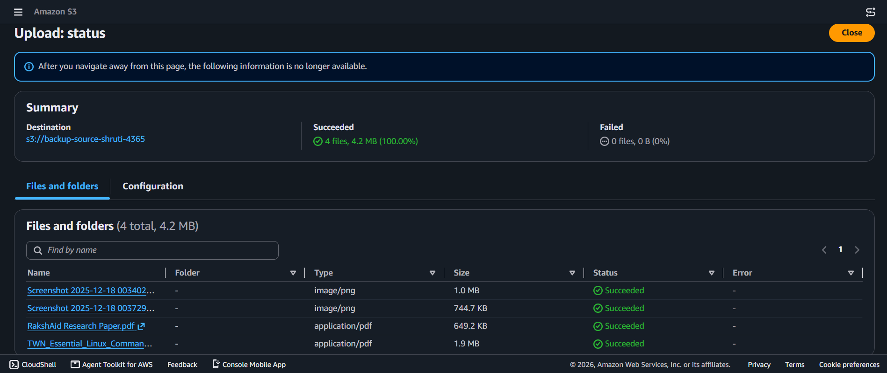
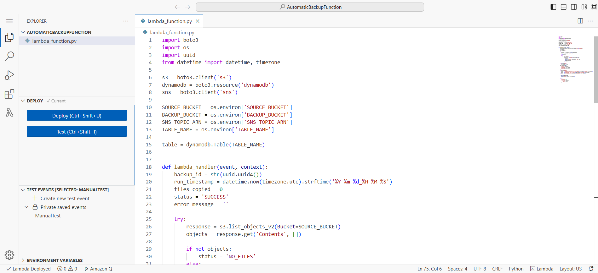
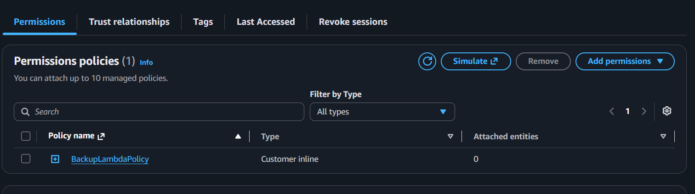
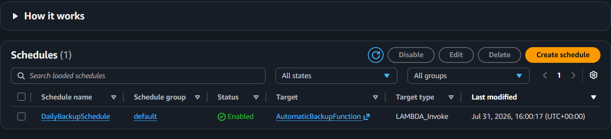
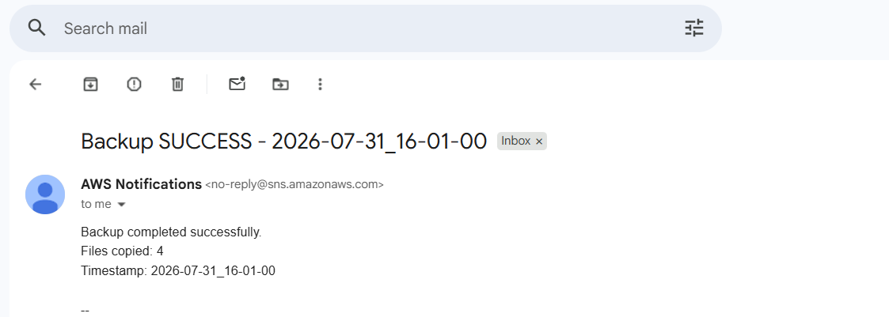
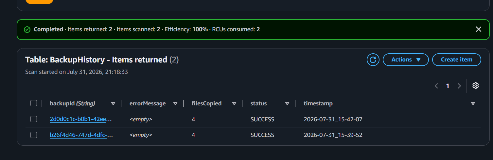
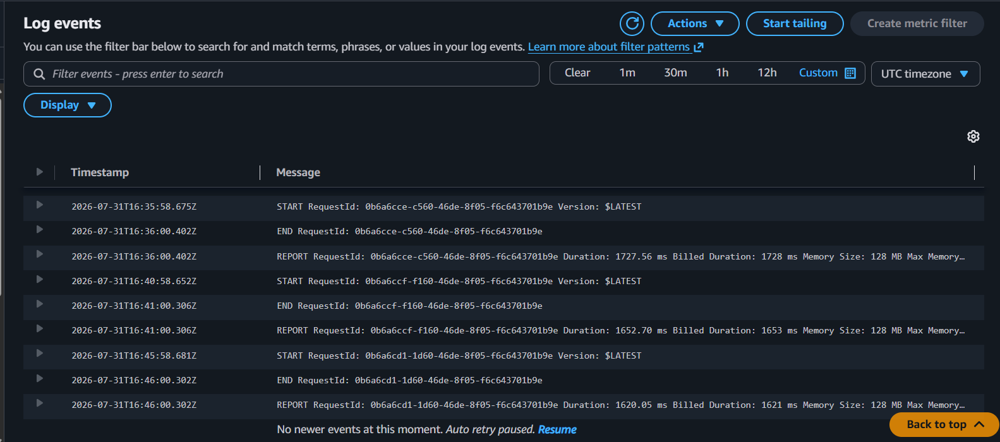
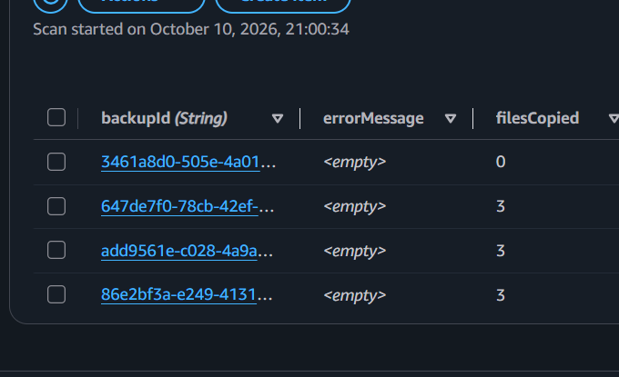

# Automatic Backup System on AWS

A serverless backup pipeline. On a schedule, a Lambda function copies every file in one S3 bucket into a timestamped folder in a second bucket, writes a row to DynamoDB for each run, and sends an email through SNS. There's no server to manage. The function runs for a couple of seconds at a time and that's all it costs.

I built it twice. The first time I clicked through the AWS console, so I'd understand what each piece does. Then I rewrote it as an AWS SAM template, so one `sam deploy` rebuilds the whole thing from scratch. This repo holds the SAM version, and the screenshots from both.

## How it works

```
EventBridge schedule
        |
        v
  Lambda function ---> S3 source bucket    (reads)
        |
        |-----------> S3 backup bucket     (writes backups/<timestamp>/<file>)
        |-----------> DynamoDB table       (one row per run)
        '-----------> SNS topic ---------> email
```

Each run lists the source bucket and copies every object to `backups/<timestamp>/<original key>`, so every run is its own snapshot and folder paths are kept. It then logs `backupId`, `timestamp`, `filesCopied`, `status` and `errorMessage` to DynamoDB and publishes an email. The status is `SUCCESS`, `NO_FILES` (the source bucket was empty) or `FAILED`. The log row and the email go out in all three cases, so a failed run still leaves a trace.

## Services

| Service | What it does here |
|---|---|
| Lambda (Python 3.12, boto3) | Does the copy, the logging and the alert |
| S3, two buckets | One holds the live files, the other holds the snapshots |
| EventBridge | Triggers the function on a schedule |
| DynamoDB (on-demand) | Run history |
| SNS | Email notification after every run |
| IAM | The function's execution role |
| CloudWatch Logs | Lambda's logs, created automatically |
| CloudFormation (through SAM) | Builds and deletes everything in `template.yaml` |

## What's in this repo

- `template.yaml`: every resource, defined as code
- `src/app.py`: the Lambda handler
- `samconfig.toml`: saved deploy settings
- `screenshots/`: evidence from both builds

## Deploy it yourself

You need an AWS account, the AWS CLI configured with an IAM user, the SAM CLI, and Docker Desktop (running, because `sam build` uses it).

1. Open `template.yaml` and change the email under `EmailSubscription` to your own.
2. Run `sam build`.
3. Run `sam deploy --guided`. Use stack name `automatic-backup-system` and region `us-east-1`, and let SAM create the IAM role. Say yes to saving the settings, and later deploys are just `sam deploy`.
4. Open the confirmation email from AWS and click **Confirm subscription**. Until you do, SNS drops every message without telling you.
5. Upload a file to the source bucket. Its name is in the `Outputs` at the end of the deploy:
   ```
   aws s3 cp somefile.txt s3://<SourceBucketName>/
   ```
6. Wait for the next scheduled run, or open the function in the Lambda console, go to the **Test** tab and click **Test**.
7. Check the backup bucket under `backups/`, the DynamoDB table, and your inbox.

The schedule is `rate(5 minutes)` so testing is quick. For a real daily backup, change it to `cron(0 2 * * ? *)` (2 AM UTC) and deploy again.

To tear it down, empty both buckets first, then delete the stack. CloudFormation can't delete a bucket that still has files in it.

```
aws s3 rm s3://<SourceBucketName> --recursive
aws s3 rm s3://<BackupBucketName> --recursive
sam delete
```

## Screenshots

### Console build (first version)

Source bucket with the sample files:



The Lambda function code:



The custom inline IAM policy on the function's role:



The EventBridge schedule:



The email SNS sent after a run:



Run history in DynamoDB:



CloudWatch log events from the scheduled runs:



### SAM build (second version)

Run history in DynamoDB after deploying from template.yaml:



## IAM

In the console build I wrote the policy by hand: five statements, each tied to a specific bucket, table or topic ARN, and no delete permission anywhere.

<details>
<summary>The hand-written policy</summary>

```json
{
  "Version": "2012-10-17",
  "Statement": [
    {
      "Sid": "ReadSourceBucket",
      "Effect": "Allow",
      "Action": ["s3:GetObject", "s3:ListBucket"],
      "Resource": [
        "arn:aws:s3:::<source-bucket>",
        "arn:aws:s3:::<source-bucket>/*"
      ]
    },
    {
      "Sid": "WriteBackupBucket",
      "Effect": "Allow",
      "Action": ["s3:PutObject"],
      "Resource": "arn:aws:s3:::<backup-bucket>/*"
    },
    {
      "Sid": "WriteDynamoDB",
      "Effect": "Allow",
      "Action": ["dynamodb:PutItem"],
      "Resource": "arn:aws:dynamodb:us-east-1:*:table/BackupHistory"
    },
    {
      "Sid": "PublishSNS",
      "Effect": "Allow",
      "Action": ["sns:Publish"],
      "Resource": "arn:aws:sns:us-east-1:*:BackupNotifications"
    },
    {
      "Sid": "WriteLogs",
      "Effect": "Allow",
      "Action": ["logs:CreateLogGroup", "logs:CreateLogStream", "logs:PutLogEvents"],
      "Resource": "arn:aws:logs:*:*:*"
    }
  ]
}
```
</details>

The SAM version uses SAM's built-in policy templates (`S3ReadPolicy`, `S3CrudPolicy`, `DynamoDBCrudPolicy`, `SNSPublishMessagePolicy`). They're tied to this stack's own bucket, table and topic, but they're looser than the hand-written policy. `S3CrudPolicy` on the backup bucket includes delete, which the function never needs. Tightening that is on the list below.

One small difference between the two builds: the console version used EventBridge Scheduler, and the SAM `Schedule` event creates a regular EventBridge rule. That's why the rule doesn't show up under Scheduler in the console. It's listed under the stack's Resources tab in CloudFormation.

## Things that went wrong

- **Root MFA.** I tried to add MFA to the root account while signed in as an IAM user with admin access. AWS doesn't allow that, on purpose. Root's security settings can only be changed by signing in as root.
- **`AccessDenied` on S3.** My first policy allowed `s3:GetObject` but not `s3:ListBucket`. Reading a known key works without it, but listing the bucket doesn't.
- **`S3 Bucket does not exist` during `sam deploy`.** After I'd deleted resources by hand, SAM's helper stack (`aws-sam-cli-managed-default`) still pointed at an upload bucket that was gone. Deleting that helper stack and deploying again with `--resolve-s3` fixed it.
- **Deleting too early.** I tore the first build down before I'd taken every screenshot. This is why the two builds' screenshots don't line up one for one.

## What I'd change next

- Tighten the SAM policy so the function can only `PutObject` on the backup bucket.
- Copy only files that changed since the last run. Right now every run is a full copy.
- Handle pagination. `list_objects_v2` returns at most 1,000 objects per call, so a bigger bucket would be missed.
- Add an S3 lifecycle rule to expire old snapshots, so the backup bucket doesn't grow forever.

At this size everything stays inside the AWS Free Tier. I deleted both builds after testing. SAM's own helper stack (`aws-sam-cli-managed-default`) stays behind, and it's an empty stack that costs nothing.